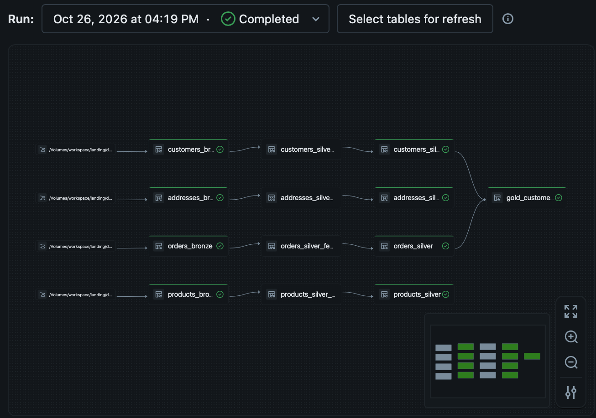
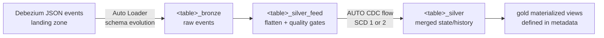
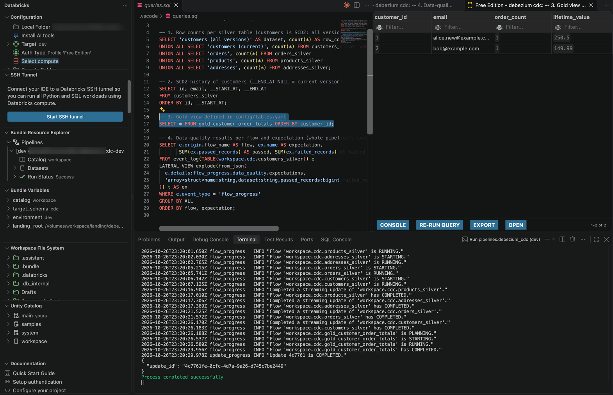

# debezium-cdc-pipeline — metadata-driven Debezium CDC ingestion

A metadata-driven framework that turns Debezium (MySQL)
change-data-capture events into up-to-date and historical tables in a
Unity Catalog medallion architecture, built on **Lakeflow Declarative
Pipelines** (formerly Delta Live Tables) with the current
`pyspark.pipelines` Python API.

Adding a source table — whether it's the 10th or the 100th — is a
one-entry change in `config/tables.yaml`. No code changes.

## Results

The pipeline was deployed and run end to end on Databricks Free
Edition (serverless compute, Unity Catalog `workspace` catalog) against
hand-crafted Debezium JSON change events. SCD 1 and SCD 2 merges,
delete handling, same-millisecond event ordering by binlog position,
tombstone dropping and expectation-based quality gates all behaved as
designed; see [Verifying the results](#verifying-the-results) for the
queries and their output.



Limitation: this is a functional verification, not a benchmark. There
are no throughput or latency numbers, the sample events are not
committed, and CI runs unit tests only for the Spark-free modules, so
changes to `flows.py` are verified only by deploying to a dev target.

## About this project

This repository is a **reference architecture**: it exists to
demonstrate, end to end, how to build metadata-driven CDC ingestion on
Databricks following data engineering, software engineering, and CI/CD
best practices — configuration as data, a validating loader that fails
fast, Spark-free unit tests, an Asset Bundle with dev/test/prod
targets, and a gated deployment workflow. It is not operating a
production workload.

Companion projects:
[debezium-mongodb-cdc-pipeline](https://github.com/morillo/debezium-mongodb-cdc-pipeline)
(the schemaless MongoDB twin of this framework, built on VARIANT),
[dlt-debezium-mysql](https://github.com/morillo/dlt-debezium-mysql) and
[dlt-debezium-mongodb](https://github.com/morillo/dlt-debezium-mongodb)
(single-source pipelines).

## Architecture



Per table in the metadata, the pipeline registers:

| Dataset | Kind | Purpose |
|---|---|---|
| `<table>_bronze` | streaming table | Raw Debezium events via Auto Loader (inference + `addNewColumns` evolution, rescued-data warning). |
| `<table>_silver_feed` | temporary view | Envelope flattened (`before` for deletes, `after` otherwise), `_cdc_*` bookkeeping columns, metadata-defined expectations and column transforms. |
| `<table>_silver` | streaming table | `create_auto_cdc_flow` merge — SCD type 1 or 2, deletes applied, sequenced by `(ts_ms, binlog position)`. |

Gold materialized views are declared entirely in metadata (`name` +
`sql`).

## Project layout

```
debezium-cdc-pipeline/
├── databricks.yml                     # Asset Bundle: dev / test / prod targets
├── resources/cdc_pipeline.pipeline.yml# Pipeline resource (UC catalog/schema)
├── config/tables.yaml                 # Table + gold metadata ({env}-templated)
├── src/
│   ├── cdc_pipeline.py                # Pipeline entry point
│   └── cdc_framework/
│       ├── config.py                  # Metadata model + validating loader
│       ├── debezium.py                # Envelope constants/helpers (Spark-free)
│       └── flows.py                   # Dataset factories (pyspark.pipelines)
├── tests/                             # Unit tests (run anywhere, no Spark)
├── docs/images/                       # README screenshots
├── .github/workflows/ci.yml           # Secret scan, lint, test, deploy
├── .github/dependabot.yml             # Weekly uv + Actions updates
└── .pre-commit-config.yaml            # gitleaks hook
```

## How a table is configured

```yaml
tables:
  - name: customers
    source_database: inventory   # or inherit from `defaults:`
    keys: [id]
    scd_type: 2                  # keep full history
    cluster_by: [id]             # liquid clustering on silver
    schema_hints: payload.after.balance DECIMAL(18,2)
    column_transforms:
      created_at: timestamp_millis(created_at)
    expectations:
      drop:
        valid_email: email IS NULL OR email LIKE '%@%'
      warn:
        positive_balance: balance >= 0
```

The landing path defaults to
`{landing_root}/{topic_template}` (e.g.
`/Volumes/cdc_dev/landing/debezium/mysql.inventory.customers`) and can
be overridden per table with `path:`. `{env}` placeholders resolve to
the `cdc.environment` pipeline setting.

Built-in safeguards applied to every table automatically:

- **Tombstones / malformed events** (`op IS NULL`) are dropped and
  counted in the pipeline event log.
- **Rows missing any primary-key column** are dropped (they cannot be
  merged deterministically) and counted.
- **Rescued data** (`_rescued_data IS NOT NULL`) raises a warning
  metric on bronze — nothing is silently lost.
- **Deterministic ordering**: events are sequenced by
  `struct(ts_ms, source.pos)` so same-millisecond update/delete pairs
  resolve by binlog position.

## Schema evolution

- **Bronze**: Auto Loader infers the schema and evolves it
  (`cloudFiles.schemaEvolutionMode=addNewColumns`). A new upstream
  column triggers one automatic stream restart, after which it flows
  through; values that don't fit the current schema land in
  `_rescued_data`.
- **Silver**: the feed view selects the row image dynamically from the
  current bronze schema, and the AUTO CDC flow evolves the silver
  table's schema automatically when new columns appear.
- **Types**: inference yields `bigint`/`double`/`string`/`boolean`.
  Debezium encodes temporal types as epoch integers — declare
  `column_transforms` (see example above) to materialize real
  dates/timestamps in silver, and/or use `schema_hints` for precise
  bronze types. For `DECIMAL` columns set
  `decimal.handling.mode=string` (or `double`) on the Debezium
  connector; the default base64-bytes encoding is not usable
  downstream.

## SDLC: dev → test → prod

The bundle defines three targets; each pins a Unity Catalog catalog
(`cdc_dev` / `cdc_test` / `cdc_prod`) and an environment name that
resolves the landing paths. Code and metadata are identical across
environments — only configuration differs.

```bash
databricks bundle validate -t dev
databricks bundle deploy   -t dev     # per-user dev copy (mode: development)
databricks bundle run      -t dev debezium_cdc

databricks bundle deploy   -t test    # via CI, as a service principal
databricks bundle deploy   -t prod    # via CI, gated release
```

The landing root defaults to `landing_root` in `config/tables.yaml`
(`/Volumes/cdc_<env>/landing/debezium`). Workspaces whose volumes live
elsewhere override it per deployment without editing the metadata file,
e.g. Databricks Free Edition (only the `workspace` catalog exists):

```bash
databricks bundle deploy -t dev --var catalog=workspace \
  --var landing_root=/Volumes/workspace/landing/debezium
```

No target commits a `workspace.host`. Set it (and the `run_as`
service principals for test/prod) in `databricks.yml` before first use,
or keep your dev host out of git in `resources/workspace.local.yml`
(git-ignored, picked up by the bundle's `include: resources/*.yml`):

```yaml
targets:
  dev:
    workspace:
      host: https://<your-dev-workspace>.cloud.databricks.com
```

The Databricks VS Code extension needs this host to offer sign-in. The
same file can also hold per-workspace variable values; see
[Running from VS Code](#running-from-vs-code).

## CI/CD

`.github/workflows/ci.yml` implements the standard flow:

1. Every PR: `gitleaks` secret scan (full history), `ruff` lint,
   `pyright` type check, `pytest` unit tests, `bundle validate`. All
   actions are pinned to commit SHAs; Dependabot bumps them, and the uv
   dependencies, weekly.
2. Merge to `main`: deploy to **test**.
3. Tag `v*`: deploy to **prod** (protect with a GitHub environment
   requiring reviewers).

The Databricks steps skip gracefully when the workspace secrets are not
configured, so the workflow stays green on repos without a wired
workspace.

Unit tests cover the metadata loader and Debezium helpers and run
without a Spark runtime. For integration testing, deploy to the dev
target and run the pipeline against sample events; validate results
with the queries in [Verifying the results](#verifying-the-results).

## Local development

```bash
uv sync                    # installs the dev tools (ruff, pyright, pytest)
uv run ruff check src tests
uv run pyright
uv run pytest

uv tool install pre-commit && pre-commit install   # gitleaks on every commit
```

## Requirements and notes

- Databricks with Unity Catalog; pipeline `channel: CURRENT`
  (serverless). The code uses `pyspark.pipelines` (`dp`) — the current
  API. On older runtimes, `import dlt` exposes the same surface under
  legacy names (`dlt.apply_changes` etc.).
- Debezium connector recommendations: keep `tombstones.on.delete`
  defaults, use `decimal.handling.mode=string`, and land files
  partitioned by topic (`mysql.<db>.<table>/...`) as this framework
  expects.
- Changing `keys`, `scd_type`, or transforms for an existing table
  requires a full refresh of that table's flows to rewrite history.

## Deployment guide

### Prerequisites

- Databricks CLI ≥ 0.230 authenticated to each workspace
  (`databricks auth login --host <workspace-url>`).
- Unity Catalog catalogs per environment (defaults: `cdc_dev`,
  `cdc_test`, `cdc_prod` — override via bundle variables).
- A landing volume per environment matching `landing_root` in
  `config/tables.yaml` (default `/Volumes/cdc_<env>/landing/debezium`),
  with Debezium events landing under `mysql.<db>.<table>/` prefixes.
- For test/prod: a service principal per environment with permission to
  create pipelines and write to its catalog.

### One-time setup

1. In `databricks.yml`, set `workspace.host` for each target (for dev
   you can use the git-ignored `resources/workspace.local.yml` instead,
   see above) and `run_as.service_principal_name` for test and prod.
2. Review `config/tables.yaml`: landing root, table list, keys.
3. In GitHub, create `test` and `prod` environments, each with
   `DATABRICKS_HOST` and `DATABRICKS_TOKEN` secrets (service-principal
   tokens), and require reviewers on `prod`.

### Deploy and run — dev (manual)

```bash
databricks bundle validate -t dev
databricks bundle deploy   -t dev
databricks bundle run      -t dev debezium_cdc
```

`mode: development` prefixes all resources with your username, so every
engineer gets an isolated copy against the dev catalog.

### Deploy — test and prod (CI only)

- Merge a PR to `main` → CI lints, tests, validates, then deploys the
  bundle to **test** as the test service principal.
- Tag a release (`git tag v1.0.0 && git push --tags`) → CI deploys the
  same commit to **prod** after the gated approval.

No human deploys to test or prod by hand; the bundle is the only
deployment path, so workspaces never drift from git.

### Post-deploy verification

```sql
-- Row counts arrived in silver
SELECT COUNT(*) FROM cdc_prod.cdc.customers_silver;

-- Data-quality outcomes (dropped tombstones, key violations, warns)
SELECT * FROM event_log(TABLE(cdc_prod.cdc.customers_silver))
WHERE event_type = 'flow_progress';
```

For the full set of checks, see
[Verifying the results](#verifying-the-results).

### Rollback and re-processing

- **Code rollback**: deploy the previous git tag
  (`git checkout v0.9.0 && databricks bundle deploy -t prod`).
- **Data reprocessing**: run the pipeline with a full refresh for the
  affected tables (`databricks bundle run -t prod debezium_cdc
  --full-refresh <table>_bronze,<table>_silver`).
- **Dev teardown**: `databricks bundle destroy -t dev` removes a
  developer's copy cleanly.

### Running on Databricks Free Edition

This pipeline was verified end-to-end on Databricks Free Edition
(serverless). Two of that edition's constraints require deviating from
the defaults above; everything else works unchanged.

1. **Use the built-in `workspace` catalog.** Free Edition uses Default
   Storage, so the CLI cannot create catalogs (`databricks catalogs
   create` fails with *"Metastore storage root URL does not exist"*).
   Instead of `cdc_dev`, override the catalog variable at deploy time —
   no code changes, this is what the bundle variable is for.

2. **Point the landing root at a volume in that catalog.** Create the
   schemas and volume, then override the `landing_root` bundle variable
   at deploy time (the committed `config/tables.yaml` stays unchanged;
   the override reaches the pipeline as the `cdc.landing_root`
   setting).

Full sequence:

```bash
# authenticate (browser OAuth; no PAT needed)
databricks auth login --host https://<workspace>.cloud.databricks.com \
  --profile free

# landing zone + target schema in the built-in catalog
databricks schemas create landing workspace --profile free
databricks schemas create cdc workspace --profile free
databricks volumes create workspace landing debezium MANAGED \
  --profile free

# land some Debezium JSON events (one directory per topic)
databricks fs cp -r ./events/ \
  dbfs:/Volumes/workspace/landing/debezium/ --profile free

# deploy and run with the catalog and landing root overridden
databricks bundle validate -t dev --var="catalog=workspace" \
  --var="landing_root=/Volumes/workspace/landing/debezium" --profile free
databricks bundle deploy   -t dev --var="catalog=workspace" \
  --var="landing_root=/Volumes/workspace/landing/debezium" --profile free
databricks bundle run      -t dev debezium_cdc --profile free
```

Tables land in `workspace.cdc` (the `target_schema` variable). The
pipeline is already `serverless: true`, which is the only compute Free
Edition offers, so no compute changes are needed. Teardown:
`databricks bundle destroy -t dev --var="catalog=workspace"
--profile free`, then drop the `workspace.cdc` and `workspace.landing`
schemas.

To skip the `--var` flags (and to run from VS Code), put the two
overrides in `resources/workspace.local.yml` as shown in the next
section.

### Running from VS Code

The [Databricks VS Code extension](https://marketplace.visualstudio.com/items?itemName=databricks.databricks)
deploys and runs the bundle from the editor; the pipeline itself runs
on serverless compute in the workspace, so Databricks Connect is not
used ("Databricks Connect disabled" in the status bar is expected).
Optionally, [SQLTools](https://marketplace.visualstudio.com/items?itemName=mtxr.sqltools)
with the Databricks driver queries the resulting tables.



**One-time setup** (all files below are git-ignored):

1. Run `uv sync`, and authenticate the CLI to your workspace
   (`databricks auth login --host <workspace-url>`).
2. Create `resources/workspace.local.yml` with the workspace host. On
   Free Edition, also set the catalog and landing root there so no
   `--var` flags are needed:

   ```yaml
   targets:
     dev:
       workspace:
         host: https://<workspace>.cloud.databricks.com
       variables:                # Free Edition only
         catalog: workspace
         landing_root: /Volumes/workspace/landing/debezium
   ```

   Check it with `databricks bundle validate -t dev`. Don't move or
   edit this file while VS Code is open; the extension re-reads it and
   reports "Invalid host name" if the host disappears.
3. Create `.vscode/settings.json`:

   ```json
   {
     "python.defaultInterpreterPath": "${workspaceFolder}/.venv/bin/python",
     "python.testing.pytestEnabled": true,
     "python.testing.pytestArgs": ["tests"],
     "databricks.python.environmentSetup": "manual",
     "sqltools.connections": [
       {
         "name": "debezium cdc",
         "driver": "Databricks",
         "connectionMethod": "VS Code Extension (beta)",
         "path": "/sql/1.0/warehouses/<warehouse-id>",
         "catalog": "workspace",
         "schema": "cdc"
       }
     ]
   }
   ```

   `environmentSetup: manual` stops the extension from rebuilding the
   uv-managed `.venv`. The SQLTools connection reuses the extension's
   login, so no token is stored; omit it if you don't use SQLTools.
   Set `catalog` to your `catalog` variable (`cdc_dev` outside Free
   Edition).

**Run:**

1. Open the repo folder itself (`code debezium-cdc-pipeline`), not a
   parent folder; the extension looks for `databricks.yml` at the
   project root. If it reports that `databricks.yml` "already exists",
   run **Databricks: Select a Databricks project folder** from the
   command palette and pick the repo root.
2. Unit tests: **Testing** view → **Run Tests** (same as
   `uv run pytest`).
3. Databricks view → **Configuration** → **Login to Databricks** → pick
   your CLI profile. Configuration shows **Target: dev**.
4. **Bundle Resource Explorer** → **Pipelines** → hover
   `[dev <you>] debezium-cdc-dev` → **Deploy the bundle and run the
   pipeline**. Dataset status appears under the pipeline; full output
   via **Databricks: Show bundle logs**.
5. Full refresh: same row → **Deploy the bundle and select pipeline
   tables for partial update** → select the tables and **Full
   refresh** → confirm.
6. Query the results: SQLTools icon in the activity bar → hover the
   **debezium cdc** connection → **Connect**. Save the queries from
   [Verifying the results](#verifying-the-results) in a `.sql` file
   (e.g. the git-ignored `.vscode/queries.sql`), put the cursor in a
   query and press `Cmd+E Cmd+E`; the result opens in a tab beside the
   editor.

### Verifying the results

Run these in the Databricks SQL Editor (with catalog `workspace` and
schema `cdc` selected) or with SQLTools from VS Code. Outside Free
Edition, use your `catalog` and `target_schema` values.

```sql
-- 1. Row counts per silver table (customers is SCD2: all versions + current)
SELECT 'customers (all versions)' AS dataset, count(*) AS row_count FROM customers_silver
UNION ALL SELECT 'customers (current)', count(*) FROM customers_silver WHERE __END_AT IS NULL
UNION ALL SELECT 'orders', count(*) FROM orders_silver
UNION ALL SELECT 'products', count(*) FROM products_silver
UNION ALL SELECT 'addresses', count(*) FROM addresses_silver;

-- 2. SCD2 history of customers (__END_AT NULL = current version)
SELECT id, email, __START_AT, __END_AT
FROM customers_silver
ORDER BY id, __START_AT;

-- 3. Gold view defined in config/tables.yaml
SELECT * FROM gold_customer_order_totals ORDER BY customer_id;

-- 4. Data-quality results per flow and expectation (whole pipeline's event log)
SELECT e.origin.flow_name AS flow, ex.name AS expectation,
       SUM(ex.passed_records) AS passed, SUM(ex.failed_records) AS failed
FROM event_log(TABLE(workspace.cdc.customers_silver)) e
LATERAL VIEW explode(from_json(
  e.details:flow_progress.data_quality.expectations,
  'array<struct<name:string,dataset:string,passed_records:bigint,failed_records:bigint>>'
)) t AS ex
WHERE e.event_type = 'flow_progress'
GROUP BY ALL
ORDER BY flow, expectation;
```

What the verification run returned:

- **Counts:** `customers_silver` 6 rows, 2 of them current;
  `orders_silver` 2; `products_silver` 3; `addresses_silver` 2.
- **SCD2 history:** Alice's email change is a closed row plus a current
  row. Carol is deleted. Dave's update and delete in the same
  millisecond are ordered by binlog position (5000, then 5001), so his
  last version is closed. `__START_AT`/`__END_AT` are the
  `(ts_ms, pos)` sequence struct.
- **Gold:** Alice has 1 order (lifetime value 250.5), Bob has 1
  (149.99).
- **Expectations:** on `customers`, `valid_debezium_op`,
  `valid_primary_key` and `valid_email` each dropped 2 records. The
  `positive_amount` warning flagged 4 order records but kept them, and
  `no_rescued_data` found nothing on any bronze table. The event log
  adds up every update, including full refreshes, so these counts grow
  with each run.
